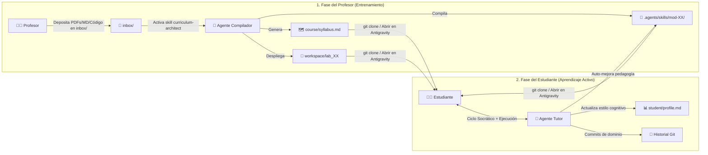

# 🐦 Colibril-Learn: Manual Operativo del Profesor y del Estudiante
*Arquitectura de Repositorios Educativos Autopoiéticos con Antigravity + Git*

> 🌐 **[🇪🇸 Leer en Español](./README.md)** | **[🇺🇸 Read in English](./README_EN.md)**

---

## 📖 Visión General del Sistema

**Colibril-Learn** transforma un repositorio Git común en un **Sistema de Tutoría Inteligente (ITS) vivo y auto-modificable**. En lugar de consumir cursos estáticos en video o PDF, el aprendizaje ocurre dentro de un entorno real de ingeniería donde:

1. **El Profesor (Arquitecto / Entrenador)** inyecta la materia prima del tema y el agente transpila ese conocimiento en un grafo curricular (`course/syllabus.md`), módulos de conocimiento bajo demanda (`.agents/skills/`) y laboratorios verificables (`workspace/`).
2. **El Estudiante** aprende conversando con el agente y resolviendo retos ejecutables, mientras el agente adapta sus propias explicaciones en disco (`student/profile.md` y `.agents/skills/`) y registra cada logro en el historial de Git (`git log`).



---

## 👨‍🏫 PARTE I: Manual del Profesor (Cómo entrenar al Agente con un Tema)

El profesor **no necesita redactar manualmente cada archivo `SKILL.md` ni programar cada test desde cero**. El propio agente actúa como compilador curricular gracias a la meta-skill [`.agents/skills/curriculum-architect/SKILL.md`](.agents/skills/curriculum-architect/SKILL.md).

### Paso 1: Crear el Repositorio desde la Semilla Base
Crea una carpeta nueva (o clona la rama semilla de `colibril-learn`) que contenga únicamente el motor base:

```text
mi-nuevo-curso/
├── AGENTS.md                                      # Reglas pedagógicas y máquina de estados
├── inbox/                                         # Carpeta vacía para depositar el material del tema
└── .agents/
    └── skills/
        ├── curriculum-architect/SKILL.md          # Meta-skill que construye el curso
        └── socratic-evaluator/SKILL.md            # Meta-skill que evalúa y adapta la clase
```

### Paso 2: Inyectar el "Tema" (3 Modalidades)

Abre la carpeta del proyecto en **Antigravity** (`File -> Open Folder...` o `agy .`) y elige cómo inyectar el contenido:

| Modalidad | ¿Qué hace el Profesor? | Comando / Prompt para entrenar al Agente |
| :--- | :--- | :--- |
| **A. Por Material Crudo (`inbox/`)**<br/>*(Recomendado para libros, historias, papers, PDFs o apuntes propios)* | Copia tus archivos (`.md`, `.pdf`, `.txt`, scripts de ejemplo) dentro de la carpeta `inbox/`. | `Lee el material en inbox/ y transpílalo en un curso práctico de [TEMA] de 5 módulos siguiendo la skill curriculum-architect.` |
| **B. Por Prompt Directo (Cero Archivos)**<br/>*(Ideal para temas estándar de la industria)* | No necesitas poner nada en `inbox/`. El agente investigará el tema por su cuenta. | `Diseña y compila un curso interactivo sobre [TEMA, ej: Concurrencia en Go] para nivel intermedio. Genera el syllabus, las skills y los laboratorios.` |
| **C. Por Código Existente (Ingeniería Inversa)**<br/>*(Ideal para onboarding técnico en empresas)* | Coloca un proyecto o microservicio real dentro de `inbox/`. | `Analiza la arquitectura del código en inbox/ y crea un curso guiado de 4 módulos donde el alumno reconstruya sus patrones clave paso a paso.` |

### Paso 3: Ajustar la Personalidad Pedagógica (Opcional)
Si deseas que el curso tenga un tono específico (por ejemplo, estilo narrativo histórico, estilo entrevista técnica de FAANG, o método de casos de Harvard), edita la **Sección 2 de [`AGENTS.md`](AGENTS.md)** antes de ejecutar el comando del Paso 2.

### Paso 4: Auditoría Docente ("Dry Run") y Publicación
Una vez que el agente termine de compilar el curso:
1. Revisa [`course/syllabus.md`](course/syllabus.md) para validar que el orden de los módulos sea el adecuado.
2. Si quieres cambiar un ejercicio o agregar un caso borde, solo pídele al agente:
   > *"En el Módulo 3, haz que el laboratorio también evalúe el manejo de excepciones y actualiza su script verificador."*
3. Verifica que [`student/progress.json`](student/progress.json) tenga el Módulo 01 en `"in_progress"` y los demás en `"locked"`, y sube el repositorio a GitHub/GitLab para tus alumnos.

---

## 👩‍🎓 PARTE II: Manual del Estudiante (Cómo aprender con el Agente)

El estudiante no interactúa con un chatbot pasivo, sino con un **entorno vivo** que recuerda su progreso, ejecuta su código y se adapta a su forma de pensar.

### Paso 1: Abrir el Curso en Antigravity
1. Clona el repositorio del curso (o abre la carpeta local):
   ```powershell
   git clone <url-del-curso>
   cd <carpeta-del-curso>
   agy .
   ```
2. Al abrir la carpeta como **Workspace activo**, Antigravity lee automáticamente [`AGENTS.md`](AGENTS.md) y activa el modo tutoría sin que tengas que configurar nada.

### Paso 2: Comandos de Estudio en el Chat
El alumno puede usar lenguaje natural en todo momento, pero estos son los **5 comandos clave** para controlar su sesión:

| Qué quiere hacer el Alumno | Qué escribir en el Chat de Antigravity | Qué hace el Agente en el Repositorio |
| :--- | :--- | :--- |
| **Arrancar o retomar la clase** *(incluso días después)* | `Inicia mi sesión de aprendizaje según el estado actual del repositorio.` | Lee `student/progress.json`, `student/profile.md` y `git log`. Retoma exactamente en el módulo y ejercicio donde te quedaste. |
| **Pedir otra forma de explicación** *(Autopoiesis)* | `Explícamelo con una tabla comparativa Antes vs. Después` *(o con un diagrama / analogía visual).* | Te lo explica como pediste, **actualiza `student/profile.md`** con tu preferencia cognitiva y **edita su propio `SKILL.md`** para enseñarte así en los siguientes módulos. |
| **Validar su solución de código** | `Evalúa mi laboratorio actual.` | Ejecuta `python .agents/skills/<modulo>/scripts/verify_labXX.py` sobre tu archivo en `workspace/`. Si falla, te da pistas socráticas; si pasa, desbloquea el siguiente módulo y hace `git commit`. |
| **Hacer una desvío / pregunta profunda ("Side-Quest")** | `Antes de avanzar, ¿cómo funciona esto por debajo en memoria? Créame un mini-ejemplo.` | Crea una prueba rápida sin dañar tu laboratorio principal, te lo demuestra en consola y luego retoma la ruta del `syllabus.md`. |
| **Ver su progreso y bitácora** | `Muéstrame mi resumen de progreso y el historial de logros.` | Lee `student/progress.json`, `student/profile.md` y ejecuta `git log --oneline --graph` para mostrarte tu portafolio de aprendizaje. |

---

## 🔥 Evidencia Empírica en este Repositorio (El Commit `d1741df`)

Este repositorio conserva intacto el historial de Git del experimento en vivo enseñando **Programación Orientada a Objetos (POO)** desde la crisis de la lógica del siglo XX ([`inbox/los-diarios-del-limite.md`](inbox/los-diarios-del-limite.md)):
1. **Módulo 01 (Bertrand Russell, 1901):** Paradoja del Barbero y Teoría de Tipos → `Class` vs `Instance` y el puntero `self` (`RecursionError`).
2. **Módulo 02 (Ludwig Wittgenstein, 1918):** El *Tractatus* → Estado y Encapsulamiento privado (`__`).
3. **Módulo 03 (Kurt Gödel, 1930):** Teorema de Incompletitud → Clases Base Abstractas (`ABC`) y Contratos.
4. **Módulo 04 (Alan Turing & Alan Kay, 1936–1972):** La Cinta Universal (Datos = Código) → Objetos y Paso de Mensajes Polimórfico.
5. **Módulo 05 (Nodo EOS-7, Svalbard):** Auto-observación recursiva → Reflexión, Introspección y Metaclases (`type`).

### ¿Qué ocurrió durante la sesión real en el `git log`?

1. **Auto-reparación de herramientas (`9eaf360`):** Al ejecutar el primer verificador en PowerShell (Windows), el agente detectó un `UnicodeEncodeError` por la codificación `cp1252`, reescribió sus propios 5 scripts verificadores para configurar `stdout` en UTF-8 y commiteó el arreglo (`chore(pedagogy)`).
2. **Autopoiesis Pedagógica (`d1741df` — Cuando el alumno pidió al agente que resolviera los ejercicios):**
   Durante el Módulo 01, en lugar de escribir el código manualmente desde cero, el estudiante le pidió al propio agente que mostrara y ejecutara la solución. El agente interpretó esta interacción como una preferencia cognitiva por el **Aprendizaje mediante Ejemplos Resueltos (*Worked-Example Mode*)**:
   - Actualizó [`student/profile.md`](student/profile.md) registrando: *"El estudiante prefiere un flujo ágil de demostración visual (tablas comparativas Antes vs. Después) y ejecución directa guiada por el agente."*
   - **Reescribió su propio archivo [`.agents/skills/mod-01-russell-tipos-y-self/SKILL.md`](.agents/skills/mod-01-russell-tipos-y-self/SKILL.md)** (`git show d1741df`) agregando la regla de mostrar tablas **❌ Con Paradoja vs. ✅ Con `self` Controlado** y ofrecer ejecutar la reparación en vivo.
   - Aplicó ese flujo de demostración interactiva del Módulo 02 al 05 (`10:53` → `10:56` → `11:00` → `11:03`).
3. **El Dilema Arquitectónico Descubierto (`worked_example` vs. `strict_socratic`):**
   Como el agente tiene permisos de escritura sobre `workspace/`, si el alumno le pide que resuelva el laboratorio, el tutor muta de *Retador Socrático* a *Demostrador en Vivo*. Esto permite al profesor configurar en [`AGENTS.md`](AGENTS.md) dos modalidades explícitas:
   - **Modo Demostración Guiada (`worked_example`):** El agente contrasta *Antes vs. Después*, repara el código en vivo y ejecuta los verificadores junto al alumno.
   - **Modo Socrático Estricto (`strict_socratic`):** Mediante reglas en `AGENTS.md` o hooks de pre-ejecución, se prohíbe al agente editar `workspace/lab_*.py`, obligando a que solo el humano pueda escribir el código que pase el verificador.

---

## 🔄 PARTE III: El Ciclo de Mejora Continua (Feedback Profesor ↔ Alumno)

Una ventaja única de que el curso sea un repositorio Git es que **el profesor puede ver cómo aprenden sus alumnos y mejorar el curso base con datos reales**:

1. **Telemetría Auditable en Git:** El historial de commits (`feat(mastery)` y `chore(pedagogy)`) junto con [`student/progress.json`](student/progress.json) documentan cada paso de la sesión.
2. **Pull Requests Pedagógicos:** Si durante el curso de un estudiante el agente mejoró una skill (commits `chore(pedagogy): ...` porque detectó una mejor analogía o corrigió un script verificador), el profesor puede hacer `git cherry-pick` de esa mejora e incorporarla al repositorio maestro para todos los futuros estudiantes.
3. **Portabilidad del Perfil Cognitivo (`student/profile.md`):** El archivo `student/profile.md` que el agente refinó durante el curso captura cómo aprende mejor ese estudiante. El alumno puede copiar su `student/profile.md` a su próximo curso de **Colibril-Learn** para que el nuevo tutor se adapte a su mente desde la primera clase.
