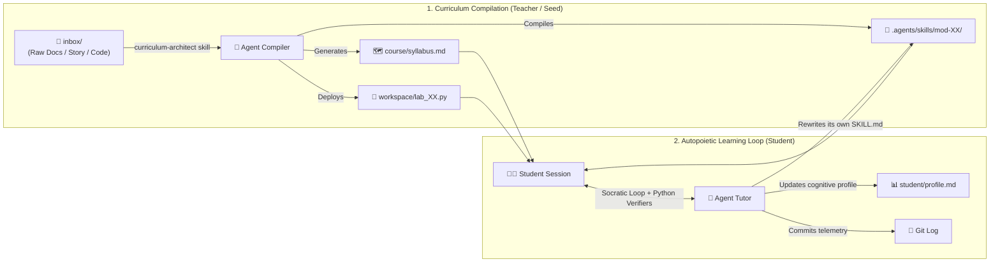

# 🐦 Colibril-Learn: Self-Modifying Educational Repositories with `AGENTS.md` + Git
*An Autopoietic Learning Harness Powered by Antigravity*

> 🌐 **[🇪🇸 Leer en Español](./README.md)** | **[🇺🇸 English Documentation](./README_EN.md)**

---

## ⚡ What is Colibril-Learn?

Most interactive coding courses are **static**: an instructor writes exercises and tests beforehand, and if an explanation doesn't click for a student, the repository cannot adapt. Conversely, chatting with an LLM in a browser is adaptive, but **stateless, unverified, and disconnected from a real codebase**.

**Colibril-Learn** combines a **Git repository**, the **`AGENTS.md` + `.agents/skills/` standard**, and a **local coding agent with read/write/execute permissions over itself** (Google Antigravity). Here, **the final build artifact of the repository is not a production app—it is the student's cognitive mastery.**



---

## 🔥 Empirical Proof: The Self-Modification Commit (`d1741df`)

This repository contains the complete, unedited Git history of our live experiment teaching **Object-Oriented Programming (OOP)** not through boring `class Dog(Animal)` examples, but through the 20th-century crisis of logic (from [`inbox/los-diarios-del-limite.md`](inbox/los-diarios-del-limite.md)):

1. **Module 01 (Bertrand Russell, 1901):** The Barber Paradox & Type Theory → `Class` vs `Instance` and the `self` pointer (`RecursionError`).
2. **Module 02 (Ludwig Wittgenstein, 1918):** The *Tractatus* (*"The world is the totality of facts"* & *"Whereof one cannot speak, thereof one must be silent"*) → Object State & Private Encapsulation (`__`).
3. **Module 03 (Kurt Gödel, 1930):** Incompleteness Theorem → Abstract Base Classes (`ABC`) & Open Contracts.
4. **Module 04 (Alan Turing & Alan Kay, 1936–1972):** The Universal Tape (Data = Code) → Objects fusing state + methods & Polymorphic Message Passing.
5. **Module 05 (Node EOS-7, Svalbard):** Recursive Self-Observation → Runtime Reflection, Introspection, and Metaclasses (`type`).

### What happened in the Git Log during the live session:

```text
* 3c726fe feat(mastery): complete mod-05-eos7-reflexion-y-metaclases and graduate course
* 15be82b feat(mastery): complete mod-04-turing-maquina-universal-y-mensajes and unlock mod-05
* eafd5bc feat(mastery): complete mod-03-godel-abstraccion-y-contratos and unlock mod-04
* b78b5b9 feat(mastery): complete mod-02-wittgenstein-estado-y-encapsulamiento and unlock mod-03
* d1741df feat(mastery): complete mod-01-russell-tipos-y-self and refine skill pedagogy
* 9578a25 chore(repo): add .gitignore and untrack __pycache__
* 61cf0b2 feat(labs): deploy interactive code laboratories for Modules 02 through 05
* 9eaf360 chore(pedagogy): auto-configure UTF-8 stdout in verifiers after observing Windows cp1252 exception
* 464e14d feat(lab-01): deploy Module 1 interactive laboratory (Russell's Razor & self)
* e2ed6b3 feat(curriculum): transpile 'Los Diarios del Limite' into 5 OOP modular skills and syllabus
* e00c109 chore(seed): initialize colibril-learn harness with AGENTS.md, meta-skills, and raw inbox text
```

1. **Self-Healing Tooling (`9eaf360`):** On the first run of `verify_lab01.py` on Windows PowerShell, the agent encountered a `cp1252` `UnicodeEncodeError`. It immediately patched all 5 verification scripts to reconfigure `stdout` to UTF-8 and committed the fix (`chore(pedagogy)`).
2. **Pedagogical Autopoiesis (`d1741df`):** During Module 01, the student asked to see a concrete code comparison. The agent observed that **side-by-side Before/After tables** (Paradoxical Code vs. Fixed Code) dramatically accelerated the student's comprehension. Without being asked to edit its config, the agent:
   - Updated [`student/profile.md`](student/profile.md) with the student's cognitive preference.
   - **Edited its own [`.agents/skills/mod-01-russell-tipos-y-self/SKILL.md`](.agents/skills/mod-01-russell-tipos-y-self/SKILL.md)** to persist this pedagogical rule (`git show d1741df`).
   - Applied that exact teaching pattern across Modules 02–05.
3. **Measurable Acceleration ([`student/progress.json`](student/progress.json)):** Once the agent adapted to the student's cognitive style, module completion time dropped to **3–4 minutes per module** (`10:53` → `10:56` → `11:00` → `11:03`).

---

## 🛠️ How It Works (For Course Creators & Students)

### 1. How a Teacher / Course Creator Trains the Agent
Start from the seed commit (`git checkout -b my-new-course e00c109`), which only contains:
- [`AGENTS.md`](AGENTS.md): The state machine (Ingestion Mode vs. Active Tutoring Mode).
- [`.agents/skills/curriculum-architect/SKILL.md`](.agents/skills/curriculum-architect/SKILL.md): Meta-skill that compiles raw material into a course.
- [`.agents/skills/socratic-evaluator/SKILL.md`](.agents/skills/socratic-evaluator/SKILL.md): Meta-skill that runs verification scripts and updates the student model.

Drop any raw material (markdown notes, PDFs, papers, or an existing codebase) into `inbox/` and prompt the agent:
> *"Read the material in `inbox/` and transpile it into a 5-module interactive course using `curriculum-architect`."*

### 2. How a Student Uses the Agent
Open the repository in **Antigravity** (`agy .`) and type:
- **`Start my learning session based on the current repository state.`** → Reads `student/progress.json`, `student/profile.md`, and `git log`, loading only the active module's `SKILL.md` (Progressive Disclosure).
- **`Explain this using a Before vs. After table`** *(or diagram / analogy)* → Adapts on the fly, updates `student/profile.md`, and refines `.agents/skills/`.
- **`Evaluate my current lab.`** → Runs `python .agents/skills/<module>/scripts/verify_labXX.py`, unlocks the next module on pass, and creates a `feat(mastery)` Git commit.
