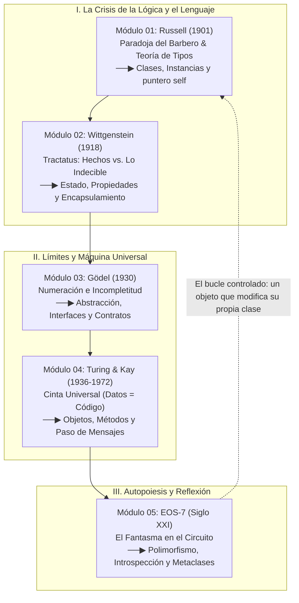

# SYLLABUS: Del Filo de la Navaja al Objeto Consciente
*Génesis Filosófica y Arquitectura del Paradigma Orientado a Objetos (POO)*

> **Tesis Central del Curso:** La Programación Orientada a Objetos no nació como una mera receta de ingeniería para organizar carpetas. Nació como la respuesta directa a una crisis de cien años en los fundamentos de la lógica, el lenguaje y la computación: desde la sangre en el cuello de **Bertrand Russell (1901)** y el lodo de **Ludwig Wittgenstein (1918)**, pasando por la pizarra de **Kurt Gödel (1930)** y la carrera de **Alan Turing (1936)**, hasta las células vivas de **Alan Kay (Smalltalk)** y la reflexión computacional (**EOS-7**).

---

## 🕸️ El Telar del Curso (Grafo de Aprendizaje)

---

## 📚 Mapa de Módulos y Skills

| Módulo | Coordenada Histórica | Concepto Nuclear de POO | Skill Asociada | Laboratorio en `workspace/` |
| :--- | :--- | :--- | :--- | :--- |
| **01** | **Bertrand Russell (1901)** *El Filo de la Navaja* | **Teoría de Tipos, `Class` vs `Instance` y `self`**: Cómo evitar el colapso autorreferencial separando el molde (`Class`) del individuo (`self`). | [`.agents/skills/mod-01-russell-tipos-y-self/SKILL.md`](../.agents/skills/mod-01-russell-tipos-y-self/SKILL.md) | `lab_01_barbero_russell.py` |
| **02** | **Ludwig Wittgenstein (1918)** *El Silencio en las Trincheras* | **Estado (Hechos) y Encapsulamiento**: *"El mundo es la totalidad de los hechos"* (atributos/estado) y *"De lo que no se puede hablar, hay que callar"* (estado privado `_` / `__` vs interfaz pública). | [`.agents/skills/mod-02-wittgenstein-estado-y-encapsulamiento/SKILL.md`](../.agents/skills/mod-02-wittgenstein-estado-y-encapsulamiento/SKILL.md) | `lab_02_tractatus_encapsulamiento.py` |
| **03** | **Kurt Gödel (1930)** *La Jaula de los Axiomas* | **Abstracción, Contratos e Interfaces (`ABC`)**: Ninguna implementación concreta agota la verdad del sistema; separar el *qué* (axioma/contrato abstracto) del *cómo* (implementación). | [`.agents/skills/mod-03-godel-abstraccion-y-contratos/SKILL.md`](../.agents/skills/mod-03-godel-abstraccion-y-contratos/SKILL.md) | `lab_03_godel_abstraccion.py` |
| **04** | **Alan Turing (1936)** *El Corredor y la Cinta Infinita* | **Fusión Datos + Código (Métodos y Paso de Mensajes)**: En la cinta universal de Turing, las instrucciones son datos. En POO, el dato y la función se funden en el **Objeto** que recibe mensajes. | [`.agents/skills/mod-04-turing-maquina-universal-y-mensajes/SKILL.md`](../.agents/skills/mod-04-turing-maquina-universal-y-mensajes/SKILL.md) | `lab_04_turing_mensajes.py` |
| **05** | **Nodo EOS-7 (Svalbard)** *El Fantasma en el Circuito* | **Reflexión, Introspección y Metaprogramación**: Cuando un objeto examina su propio tipo (`type`, `getattr`, metaclases) sin caer en un bucle infinito destructivo. | [`.agents/skills/mod-05-eos7-reflexion-y-metaclases/SKILL.md`](../.agents/skills/mod-05-eos7-reflexion-y-metaclases/SKILL.md) | `lab_05_eos7_reflexion.py` |
